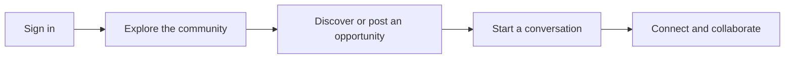
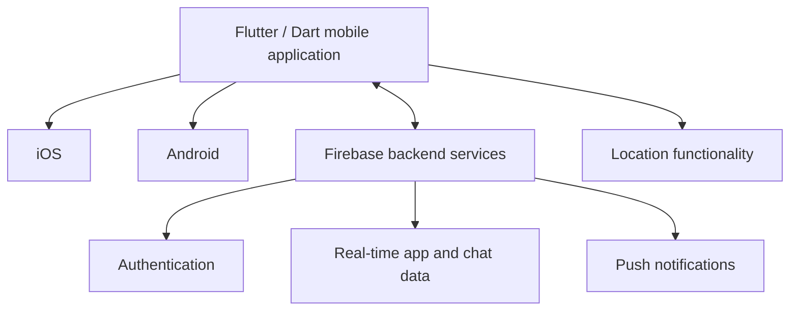

# Beehive

### A campus community, across campuses.

Beehive connects students and alumni across Singapore universities to discover opportunities, share listings, and start conversations.

**Flutter · Dart · Firebase · iOS & Android**

[View on the App Store](https://apps.apple.com/sg/app/beehive-sg/id6741799507) · [Explore the product](#product) · [Engineering overview](#engineering)

> **Product and engineering showcase.** The production source code is private. This repository documents the product and selected engineering work.

## At a glance

| | |
| --- | --- |
| Built by | [Paluk Gupta](https://github.com/paluuuk) |
| Audience | University students and alumni in Singapore |
| Platforms | iOS and Android |
| Reported milestone | 1,000+ active users across 11 Singapore universities |
| Core technology | Flutter, Dart, Firebase |

The reach figure is a project milestone, rather than a live usage counter.

## Product

Campus opportunities often sit in separate university groups and disconnected conversations. Beehive brings discovery and direct communication into one mobile experience.

- **Discover and offer opportunities:** browse and post listings for projects, gigs, tutoring, events, housing, and collaboration.
- **Connect across campuses:** reach students and alumni beyond a single university community.
- **Continue the conversation:** use built-in real-time chat to discuss a listing or opportunity.
- **Stay connected:** authentication, push notifications, and location functionality support the mobile experience.

### A typical journey

## Engineering

I developed and published the Flutter application for iOS and Android, and integrated Firebase for authentication, notifications, location-related functionality, and real-time chat.

| Area | Work delivered |
| --- | --- |
| Cross-platform mobile | A Flutter and Dart application released for iOS and Android |
| Identity | Firebase authentication integrated into the app |
| Communication | Real-time user chat and push notifications |
| Discovery | Campus opportunity listings and location functionality |
| Delivery | Published mobile applications serving a university community |

### System overview

This diagram describes the main responsibilities at a public overview level.

## Links

- **iOS:** [Beehive SG on the App Store](https://apps.apple.com/sg/app/beehive-sg/id6741799507)
- **Builder:** [Paluk Gupta on GitHub](https://github.com/paluuuk)

## Repository scope

This is a documentation-only showcase. Production application code, backend configuration, credentials, and user data remain private. There is no runnable application or open-source implementation in this repository.

